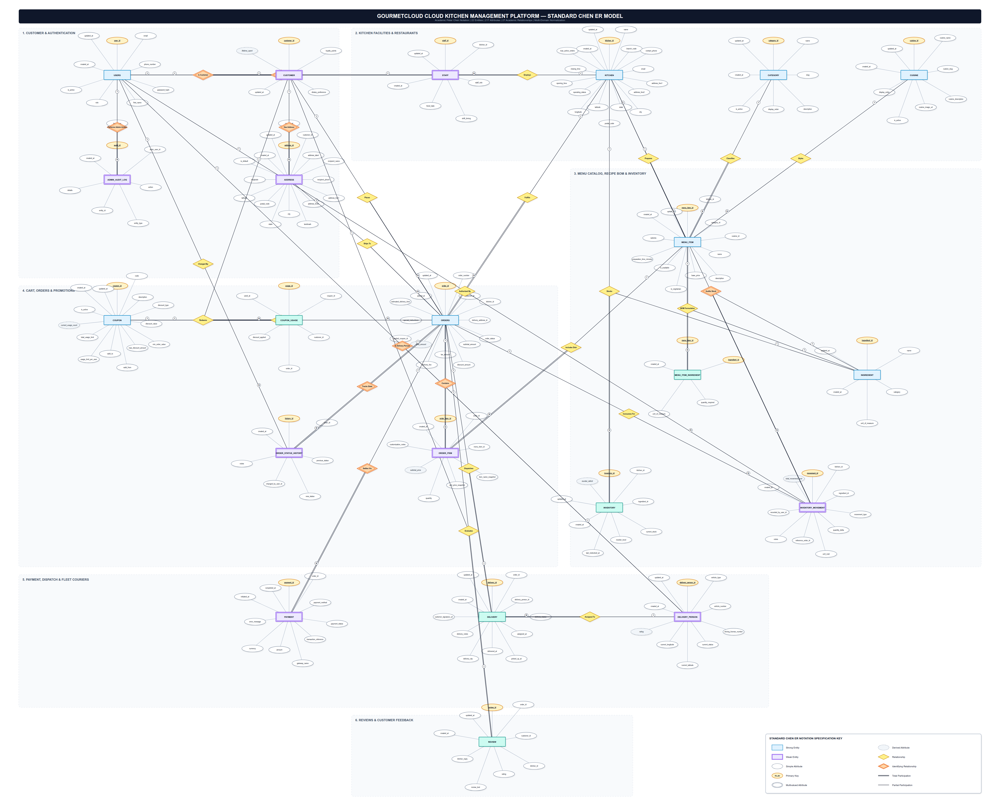
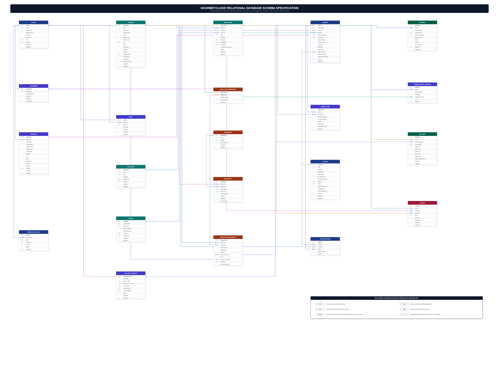

# GourmetCloud: Cloud Kitchen Management & Online Food Ordering Platform

[](https://fastapi.tiangolo.com)
[](https://react.dev)
[](https://www.mysql.com)
[](https://redis.io)
[](https://tailwindcss.com)
[](docs/TEST_REPORT.md)

A production-grade, distributed Cloud Kitchen Management and Online Food Ordering System architected for dark kitchens, multi-branch food preparation fulfillment, real-time inventory recipe tracking, automated delivery logistics, and customer ordering.

---

## 1. System Technology Stack & Architectural Justifications (Requirement L)

The GourmetCloud platform utilizes a polyglot persistence architecture combining a relational source of truth with an in-memory acceleration tier. Below is the technical justification for each selected technology:

| Technology | Specification | Technical Justification & Engineering Role |
| :--- | :--- | :--- |
| **MySQL 8.0 (InnoDB)** | Relational Source of Truth | Authoritative **Source of Truth (SoT)** providing ACID transaction guarantees (`REPEATABLE READ`), write-ahead logging (WAL), B-tree indexes, referential integrity (`FOREIGN KEY` cascading/restricting), domain `CHECK` constraints, recursive CTEs (`WITH RECURSIVE`), and audit triggers. Handles financial settlement, customer records, recipe bill of materials, and historical reporting. |
| **Redis 7.0** | In-Memory NoSQL Acceleration | High-throughput sub-millisecond key-value and data structure store. Dedicated to high-frequency ephemeral state: shopping carts (`Hash` with 7-day rolling TTL), token invalidation/sessions (`Hash`), catalog response caching (`String` JSON with 1-hour TTL), live order courier telemetry, and real-time best-selling dish recommendations (`Sorted Set`). Prevents MySQL disk lock contention during high concurrency. |
| **FastAPI** | Python 3.12+ ASGI Framework | High-performance asynchronous Python backend built on Starlette and Uvicorn. Delivers native `async`/`await` non-blocking I/O, automatic OpenAPI 3.1 / Swagger documentation generation, and native integration with Python type annotations. |
| **SQLAlchemy 2.0** | Declarative ORM & Query Engine | Type-safe declarative mapping with `Mapped[]` and `mapped_column()`, connection pooling with pre-ping validation, session unit-of-work transaction management, and robust protection against SQL injection via parameterized queries. |
| **Pydantic v2** | Rust-Powered Data Validation | Strict schema validation, sanitization, and serialization/deserialization via `pydantic-core` compiled in Rust. Enforces request/response body schemas and eliminates invalid data at API boundaries. |
| **JWT & Bcrypt** | Security & Authentication | Stateless HMAC-SHA256 JSON Web Tokens (Bearer) for scalable cross-service authorization. Passwords hashed using Bcrypt with 12 salt rounds, resisting brute-force and dictionary attacks. Strict role-based access control (RBAC) across 4 roles: `CUSTOMER`, `ADMIN`, `KITCHEN_STAFF`, and `DELIVERY_PERSON`. |
| **React 18 & Vite 5** | Frontend Single Page Application | Declarative component UI utilizing React 18 concurrent rendering features. Bundled with Vite 5 leveraging native browser ES modules (ESM) for instantaneous Hot Module Replacement (HMR < 50ms) and highly optimized Rollup production builds. |
| **Tailwind CSS 3.4** | Utility-First CSS Framework | Zero runtime overhead CSS with a Just-In-Time (JIT) compiler. Supplies a consistent design system (colors, typography, responsive breakpoints) across all 33 role-specific application pages. |

---

## 2. Polyglot Architecture & End-to-End Data Flow

```text
                                  +-----------------------------+
                                  |     React 18 + Vite SPA     |
                                  |   (Tailwind CSS + Axios)    |
                                  +--------------+--------------+
                                                 |
                                         HTTPS / JSON / JWT
                                                 |
                                                 v
                                  +-----------------------------+
                                  |   FastAPI REST API Server   |
                                  |  (Pydantic v2 + Auth Guard) |
                                  +-------+--------------+------+
                                          |              |
                    (Cache-Aside / Ephemeral)          (ACID Writes / Relational)
                                          |              |
                                          v              v
                           +--------------------+  +----------------------+
                           |   Redis 7 NoSQL    |  |  MySQL 8.0 (InnoDB)  |
                           |  - Carts (Hash)    |  |  - 22 Relational Tbls|
                           |  - Sessions (Hash) |  |  - Foreign Key Rules |
                           |  - Menu (String)   |  |  - Check Constraints |
                           |  - ZSET Leaderboard|  |  - Triggers & Views  |
                           |  - Pub/Sub Channel |  |  - Stored Procedures |
                           +--------------------+  +----------------------+
```

### Why MySQL is the Primary Source of Truth and Redis is Ephemeral
1. **Financial and Transactional Invariants:** An order checkout involves inserting into `orders`, creating $N$ rows in `order_item`, recording a `payment`, deducting stock from `inventory`, creating an `inventory_movement` journal entry, and recording `coupon_usage`. If payment fails or stock is exhausted, MySQL rolls back atomically. Redis transactions (`MULTI`/`EXEC`) lack relational isolation and conditional rollback semantics.
2. **Referential Integrity:** MySQL enforces foreign keys and cascade rules at the storage engine level. In Redis, relational graphs must be maintained manually in software, which risks orphaned records.
3. **Durability Guarantee:** MySQL writes to disk with Write-Ahead Logging (WAL) and `innodb_flush_log_at_trx_commit = 1`. In contrast, Redis primarily operates in RAM; using Redis for permanent orders would risk data loss during unexpected server power events.
4. **Complex Joins & Analytics:** Complex multi-table aggregations (e.g. 7-table logistics audit, recipe bill-of-materials traversal, revenue breakdowns) are solved in MySQL via B-tree index scans, which would be inefficient if performed manually in application RAM.

---

## 3. Database Design: ER Model & Relational Schema (Requirements E, H, I)

The database architecture is strictly normalized to 3NF/BCNF across **22 tables**, **35 foreign keys**, **20 unique constraints**, **33 domain CHECK constraints**, and **29 B-tree secondary performance indexes**.

Detailed theoretical documentation, formal Chen specifications, schema dictionary, and normalization proofs are documented in **[`docs/ER_AND_RELATIONAL_SCHEMA.md`](docs/ER_AND_RELATIONAL_SCHEMA.md)**.

### 3.1 Academic Standard Chen ER Model (Peter Chen Notation)
*Complete university DBMS textbook ER model featuring rectangles (strong entities), double rectangles (weak entities), ovals (simple attributes), underlined ovals (PKs), dashed ovals (derived attributes), diamonds (relationships), double diamonds (identifying relationships), double lines (total participation), and cardinalities (1:1, 1:N, M:N).*

<p align="center">
  
</p>

- **Draw.io Editable Source:** [`ER_Model_Cloud_Kitchen.drawio`](ER_Model_Cloud_Kitchen.drawio)
- **Vector SVG Artifact:** [`ER_Model_Cloud_Kitchen.svg`](ER_Model_Cloud_Kitchen.svg)
- **High-Resolution PNG (4800x3900):** [`ER_Model_Cloud_Kitchen.png`](ER_Model_Cloud_Kitchen.png)

### 3.2 Academic Relational Schema Diagram (Tabular Notation)
*Standard relational schema diagram modeling all 22 relations as rectangular tables with shaded headers, dedicated PK/FK key classification columns, attribute-name columns, and directional referential integrity connectors.*

<p align="center">
  
</p>

- **Draw.io Editable Source:** [`Relational_Schema_Cloud_Kitchen.drawio`](Relational_Schema_Cloud_Kitchen.drawio)
- **Vector SVG Artifact:** [`Relational_Schema_Cloud_Kitchen.svg`](Relational_Schema_Cloud_Kitchen.svg)
- **High-Resolution PNG (4800x3641):** [`Relational_Schema_Cloud_Kitchen.png`](Relational_Schema_Cloud_Kitchen.png)

### 3.3 Engineering Crow's Foot ER & Physical Schema Views
*Additional engineering diagrams compiled via Graphviz (`assets/diagrams/er_model.png` and `assets/diagrams/relational_schema.png`) are documented in [`docs/ER_AND_RELATIONAL_SCHEMA.md`](docs/ER_AND_RELATIONAL_SCHEMA.md).*

---

## 4. Directory Structure

```
PROJECT/
├── README.md                      # Primary project overview and technical documentation
├── .env.example                   # Baseline environment configuration template
├── assets/                        # Design assets and compiled visual diagrams
│   └── diagrams/                  # Publication-grade database architecture diagrams
│       ├── er_model.png           # High-resolution Crow's Foot ER Model (300 DPI)
│       ├── relational_schema.png  # High-resolution Physical Relational Schema Diagram
│       ├── er_model.dot           # Graphviz DOT source for ER Model
│       ├── relational_schema.dot  # Graphviz DOT source for Physical Schema
│       ├── er_model.mmd           # Mermaid.js source definition
│       ├── er_model.svg           # Scalable vector graphics artifact
│       └── relational_schema.svg  # Scalable vector graphics artifact
├── docs/                          # Comprehensive technical documentation
│   ├── ER_AND_RELATIONAL_SCHEMA.md # Master 22-entity ER model, Chen tables, Relational Schema & 3NF/BCNF Proofs
│   ├── DBMS_RUBRIC_COMPLIANCE.md     # Academic DBMS evaluation rubric compliance matrix & Viva Q&A
│   ├── MYSQL_ROLE_PRIVILEGE_MANAGEMENT.md # MySQL 8.0 RBAC, Privilege Matrix, GRANT/REVOKE, PoLP
│   ├── REDIS_DESIGN.md               # Redis NoSQL data structures, TTL, commands & CRUD harness
│   ├── FINAL_ARCHITECTURE_REPORT.md  # System layers, data flow, RBAC, Redis topology
│   ├── API_REFERENCE.md              # Complete REST endpoint inventory (14 modules)
│   ├── TEST_REPORT.md                # 98-test suite report, Workflows A–E, concurrency
│   ├── SECURITY_AUDIT.md             # OWASP Top 10, IDOR, SQLi, and authentication review
│   ├── PERFORMANCE_REPORT.md         # N+1 query fixes, Cache-Aside benchmarks, latency
│   ├── DEPLOYMENT_GUIDE.md           # Production runbook, systemd, Nginx, backups
│   └── DATABASE_GUIDE.md             # 22-table schema dictionary & validation queries
├── database/                      # Relational schema DDL, indexes, and academic SQL scripts
│   ├── schema.sql                    # Authoritative DDL (22 tables, constraints, trigger)
│   ├── indexes.sql                   # Performance B-Tree secondary indexes
│   ├── sample_data.sql               # Seed fixtures and baseline records
│   ├── dml_operations.sql            # Requirement M: INSERT, SELECT, UPDATE, DELETE & Transactions
│   ├── advanced_queries.sql          # Requirement N: JOINs, Nested, Correlated & Recursive CTEs
│   ├── advanced_sql_objects.sql      # Requirement O: Stored Procedures, Functions, Triggers & CTEs
│   └── role_privilege_management.sql # Requirement R: MySQL 8.0 Roles, Grants, Revoke & Test Harness
├── backend/                       # FastAPI application
│   ├── requirements.txt              # Locked Python dependencies
│   ├── pytest.ini                   # Pytest test suite configuration
│   ├── scripts/                      # Operational verification scripts
│   │   ├── verify_database.py        # Safe read-only schema and constraint verifier
│   │   └── redis_crud_demo.py        # Live Redis CRUD and NoSQL demonstration script
│   ├── app/
│   │   ├── main.py                  # ASGI FastAPI application entrypoint & lifespan
│   │   ├── core/                    # Security, hashing, JWT, configuration settings
│   │   ├── db/                      # MySQL engine, connection pooling, Redis manager
│   │   ├── models/                  # SQLAlchemy 2.x declarative entity models (22 tables)
│   │   ├── schemas/                 # Pydantic v2 schemas and validation models
│   │   ├── repositories/            # Abstracted database access routines
│   │   ├── services/                # Business logic, state machines, and calculations
│   │   └── api/
│   │       ├── router.py            # Master /api/v1 router registration
│   │       └── routes/              # 14 isolated domain endpoint routers
│   └── tests/                       # Comprehensive pytest suite (98 automated tests)
└── frontend/                      # React + Vite single page application
    ├── package.json                 # Node.js dependencies
    ├── vite.config.js               # Vite build configuration
    ├── tailwind.config.js           # Tailwind CSS theme configuration
    └── src/
        ├── App.jsx                  # Main application router and shell (33 routes)
        ├── services/api.js          # Axios API clients
        ├── components/              # Presentation components (Navbar, Modal, Alert, etc.)
        ├── context/                 # AuthContext and CartContext global state
        └── pages/                   # 33 role-specific view pages
```

---

## 4. Local Environment Setup & Verification

### 4.1 Prerequisites
- Linux (Ubuntu 22.04 / 24.04 LTS or compatible)
- Python 3.12+ with virtual environment
- Node.js 18+ and `npm`
- MySQL 8.0+
- Redis 7.0+

### 4.2 Database Verification & Demonstration Scripts
```bash
# 1. Run safe database schema and constraint verification (Non-destructive)
backend/.venv/bin/python backend/scripts/verify_database.py

# 2. Run live NoSQL Redis CRUD demonstration harness
backend/.venv/bin/python backend/scripts/redis_crud_demo.py
```

### 4.3 Automated Test Suite Execution
```bash
# Run full automated test suite (All 98 tests)
backend/.venv/bin/pytest backend/tests -v
```

### 4.4 Frontend Production Build
```bash
cd frontend
npm run build
```

---

## 5. Academic Requirement SQL Scripts

| Rubric Requirement | File Location | Key Capabilities Demonstrated |
| :--- | :--- | :--- |
| **Requirement E & H (ER Model)** | `docs/ER_AND_RELATIONAL_SCHEMA.md`<br>`assets/diagrams/er_model.png` | Publication-grade 22-entity Crow's Foot ER diagram, Chen specification tables, strong/weak entities, cardinalities. |
| **Requirement B, C, F & I (Relational Schema)** | `docs/ER_AND_RELATIONAL_SCHEMA.md`<br>`assets/diagrams/relational_schema.png` | Formal 3NF/BCNF relational notation, data dictionary, candidate keys, composite FKs, referential cascading matrix, normalization proofs. |
| **Requirement G (Data Dictionary)** | `docs/ER_AND_RELATIONAL_SCHEMA.md` | Full column data types, constraints, nullability, defaults, descriptions for all 22 tables. |
| **Requirement J (DDL & Verification)** | `database/schema.sql`<br>`backend/scripts/verify_database.py` | 22 CREATE TABLE definitions, domain CHECK constraints, B-tree indexes, safe verification script. |
| **Requirement K & P (Redis NoSQL)** | `docs/REDIS_DESIGN.md`<br>`backend/scripts/redis_crud_demo.py`<br>`backend/tests/test_redis_crud.py` | Redis Hashes, Strings, TTL, Sorted Sets leaderboard, Pub/Sub, CRUD script, automated tests. |
| **Requirement M (DML Operations)** | `database/dml_operations.sql` | INSERT (single/multi-row), SELECT, UPDATE, safe DELETE, `START TRANSACTION`, `COMMIT`, `ROLLBACK`. |
| **Requirement N (Advanced Queries)** | `database/advanced_queries.sql` | INNER/LEFT/RIGHT/Multi-table JOINs, Nested queries (WHERE/FROM/SELECT), Correlated queries, `WITH RECURSIVE` date series, window functions. |
| **Requirement O (Advanced SQL Objects)**| `database/advanced_sql_objects.sql`| 3 Stored Procedures, 2 Stored Functions, Audit Triggers, 3 CTE demonstrations, CALL/SELECT harness. |
| **Requirement R (MySQL Roles & Privileges)**| `database/role_privilege_management.sql`<br>`docs/MYSQL_ROLE_PRIVILEGE_MANAGEMENT.md` | MySQL 8.0 RBAC: 4 roles, 4 users, PoLP grants, 22-table matrix, REVOKE demo, negative test proofs. |
| **Requirement Q (Next.js Proposal)** | `docs/DBMS_RUBRIC_COMPLIANCE.md` | Detailed architectural Next.js App Router migration proposal with risk assessment. |
| **Requirement T & U (Compliance & Viva)**| `docs/DBMS_RUBRIC_COMPLIANCE.md` | Comprehensive rubric compliance report, module breakdown, Viva Q&A with 12 database topics. |

---

## 6. Baseline Seed Credentials (Development)

| Role | Email | Password | Primary Dashboard |
| :--- | :--- | :--- | :--- |
| **Administrator** | `admin@test.com` | `Password@123` | `/admin/dashboard` |
| **Kitchen Manager** | `manager1@test.com` | `Password@123` | `/kitchen/dashboard` |
| **Line Cook** | `staff1@test.com` | `Password@123` | `/kitchen/orders` |
| **Delivery Courier** | `driver1@test.com` | `Password@123` | `/delivery/dashboard` |
| **Customer** | `customer1@test.com` | `Password@123` | `/` |
